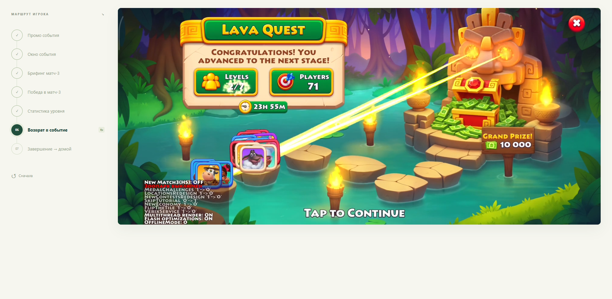

# Jungle Quest — кликабельное демо

[Открыть демо в браузере](https://vladislavserenkodm.github.io/FlowDemo/)

Короткий флоу события: промо → подбор игроков → событие → брифинг → победа → статистика → возврат в событие.

На странице находятся демо и семь шагов слева. При первом входе в событие показывается инфоокно; один тап в любом месте закрывает его. Победа, статистика и возврат в событие используют оригинальные анимации. Они проигрываются один раз, сохраняют последний кадр и пропускаются тапом. «Сначала» перезапускает демо.



## Редактирование

Готовая страница — `index.html`, исходники — `source/`. Все изображения и видео встроены в HTML, поэтому страницу также можно открыть локально без сервера.

После изменения исходников выполните из корня репозитория:

```sh
python source/assemble.py
```

Опубликуйте обновлённые исходники и `index.html` в ветке `main`. GitHub Pages использует корень этой ветки; файл `.nojekyll` отключает обработку Jekyll.

Флоу, инфоокно, переходы по тапу, воспроизведение анимаций и отсутствие внешних запросов проверены в Chrome. Результат локальной проверки — `verification.json`.
